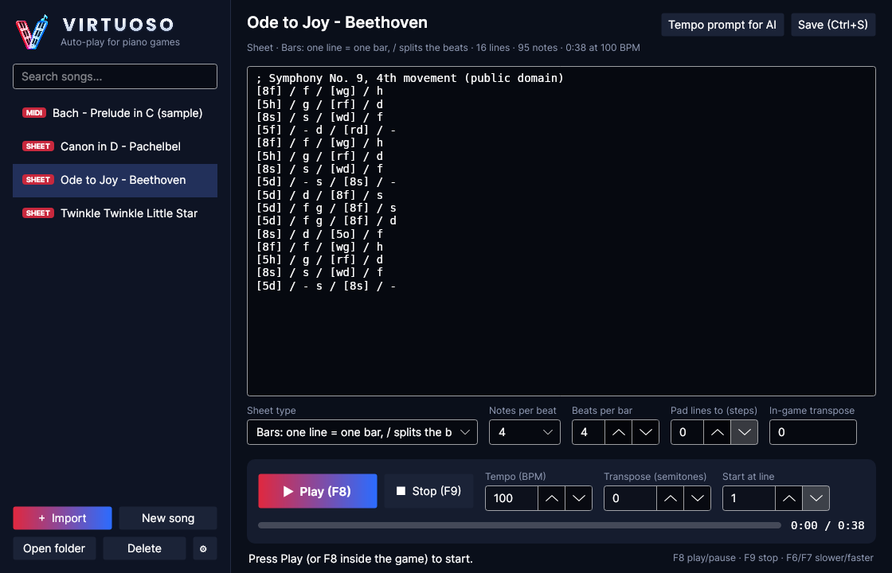
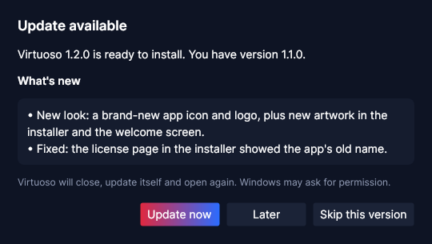

<div align="center">


<br>

[](https://github.com/tuforsa-rgb/virtuoso/releases/latest)
[](https://github.com/tuforsa-rgb/virtuoso/releases)
-0A0F1A?style=flat-square&logo=windows&logoColor=white)


### [⬇&nbsp; Download the latest version](https://github.com/tuforsa-rgb/virtuoso/releases/latest)

**Virtuoso** plays piano songs for you in piano games.<br>
Load a sheet or a MIDI file, press **F8** in the game, and listen.

</div>

---

<p align="center">
  
</p>

## ✨ Features

| | |
|---|---|
| 🎼 **Sheets** | Paste or import Virtual Piano letter sheets (`.txt`). Three layouts are understood: grid, space-separated and bars (one line = one bar). Settings written at the top of a sheet (`; bpm: 120`) are applied automatically. |
| 🎹 **MIDI files** | Import `.mid` files, pick the tracks to play, skip drums, and let Virtuoso find the key that fits the 61 in-game keys best. Notes outside the range are moved to the nearest octave. |
| ⏱️ **Precise timing** | A dedicated scheduler keeps every note on time, even for long songs and when you change the speed in the middle of a song. |
| ⌨️ **Global hotkeys** | Control playback from inside the game — no need to switch windows. |
| 🎚️ **Full control** | Tempo, speed, transpose, start from any line or bar, key hold time, countdown and lead-in delay. |
| 🌏 **7 languages** | English, Tiếng Việt, 简体中文, Français, 日本語, 한국어, हिन्दी. |
| 🔔 **System tray** | Keeps running quietly in the tray; play, pause and stop from the tray menu. |
| 🔄 **Automatic updates** | Virtuoso tells you when a new version is out and installs it in one click. Every update is digitally signed and checked before it runs. |

<p align="center">
  
</p>

## 📥 Installation

1. Go to **[Releases](https://github.com/tuforsa-rgb/virtuoso/releases/latest)** and download `Virtuoso-Setup-x.y.z.exe`.
2. Run the installer, choose your language, and follow the steps. You can create a desktop shortcut and start Virtuoso with Windows.
3. Open **Virtuoso** from the Start menu or the desktop.

> [!NOTE]
> Virtuoso is new and not yet code-signed, so Windows may warn you the first time.
> - **"Windows protected your PC"** (SmartScreen): click **More info → Run anyway**.
> - **Smart App Control** blocks apps that aren't signed. If it is turned on, Virtuoso can't run until it is turned off (Windows Security → App & browser control → Smart App Control).

## 🚀 Quick start

1. Click **+ Import** and choose sheets (`.txt`) or MIDI files (`.mid`) — or click **New song** and paste a sheet.
2. Select the song in the list and check the tempo.
3. Open your piano game and click into the game window.
4. Press **F8** to start. Virtuoso counts down, then plays.
5. Press **F8** again to pause, **F9** to stop.

### Hotkeys

| Key | Action |
|:---:|---|
| <kbd>F8</kbd> | Play / pause |
| <kbd>F9</kbd> | Stop |
| <kbd>F6</kbd> | Slower |
| <kbd>F7</kbd> | Faster |

The hotkeys work while the game is in front and are not passed on to the game.

## 🎼 Sheet formats

Virtuoso uses the standard 61-key Virtual Piano layout (C2–C7). Lowercase letters and numbers are white keys, Shift + key are black keys, and `[ ]` plays a chord.

<details>
<summary><b>Bars</b> — one line is one bar, <code>/</code> splits the beats</summary>

```
; title: Ode to Joy
; bpm: 100
; mode: bars
; beatsperbar: 4
[8f] / f / [wg] / h
[5h] / g / [rf] / d
[8s] / s / [wd] / f
[5f] / - d / [rd] / -
```
Inside a beat, notes share the time equally (`- d` = rest, then D on the off-beat).
</details>

<details>
<summary><b>Grid</b> — every character or space is one step</summary>

```
; bpm: 120
; mode: grid
; notesperbeat: 4
t t y t i u   t t y t o i
```
</details>

<details>
<summary><b>Space-separated</b> — every note or chord is one step</summary>

```
; bpm: 90
; mode: spaced
; notesperbeat: 2
t t y t i u - t t y t o i
```
`-` is a rest of one step.
</details>

Not sure about the tempo? **Tempo prompt for AI** copies a ready-made question you can paste into any AI assistant to get the right settings for your sheet.

## 🔄 Updates

Virtuoso checks for a new version when it starts and every 12 hours. When one is available you'll see what's new and can choose **Update now**, **Later** or **Skip this version**. The update downloads, Virtuoso closes, installs it and opens again — your songs, settings and language stay as they are.

You can turn automatic checks off, or check by hand, in **Settings → Updates** or from the tray menu.

> Updates are published here as GitHub Releases. Each one is signed with the Virtuoso release key; a file that doesn't match its signature and checksum is deleted and never run.

<p align="center">
  
</p>

## 🛠️ Troubleshooting

<details>
<summary><b>The game misses some notes</b></summary>

Open **Settings** and raise **Key hold** (for example from 40 to 60 ms). Some games need keys held a little longer to register.
</details>

<details>
<summary><b>Nothing happens when I press F8</b></summary>

Make sure the game window is active (click into it first). If another program already uses F6–F9, Virtuoso shows a message in the status bar — close that program and restart Virtuoso.
</details>

<details>
<summary><b>Wrong notes / everything sounds shifted</b></summary>

Turn **Caps Lock** off. If the sheet was written for a transposed piano, set **In-game transpose** to the value written on the sheet.
</details>

<details>
<summary><b>The window is blank or flickers</b></summary>

Start Virtuoso with software rendering: right-click the shortcut → Properties → add <code>--software-render</code> at the end of <i>Target</i>.
</details>

<details>
<summary><b>Where are my songs stored?</b></summary>

In `%AppData%\Virtuoso\Songs`. Click **Open folder** in the app to go there. Uninstalling asks before deleting them.
</details>

## 💻 System requirements

- Windows 10 or Windows 11, 64-bit
- About 100 MB of disk space
- No extra runtime needed — everything is included in the installer

## 🔒 Privacy

Virtuoso does not collect or send any personal data. The only internet access is the update check, which downloads release information from this page.

## 📝 Changelog

**1.2.0**
- New look: a brand-new app icon and logo, plus new artwork in the installer and the welcome screen.
- Fixed: the license page in the installer showed the app's old name.

**1.1.0**
- Automatic updates: checks for new versions, downloads and installs them in one click (signed and verified).
- New **Updates** section in Settings and **Check for updates** in the tray menu.

**1.0.0**
- First release: sheets and MIDI, global hotkeys, system tray, installer, 7 languages.

## ⚖️ Disclaimer & license

Virtuoso simulates keyboard presses to play virtual pianos. Some games and platforms do not allow automation software — you are responsible for following the rules of the games you use it with. Please don't use it in contests or rankings.

Virtuoso is an independent product and is **not affiliated with, endorsed by or sponsored by Roblox Corporation** or any game developer. All trademarks belong to their respective owners. No songs are included; only load music you have the right to use.

© 2026 Virtuoso. All rights reserved. Use of the software is subject to the license agreement shown in the installer.
