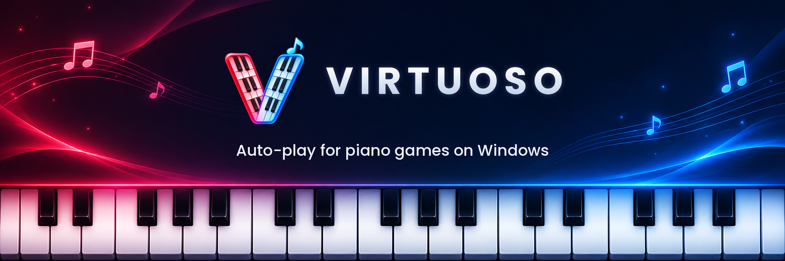
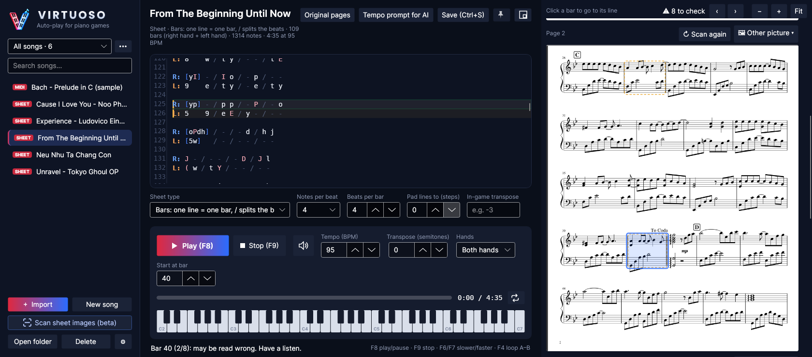
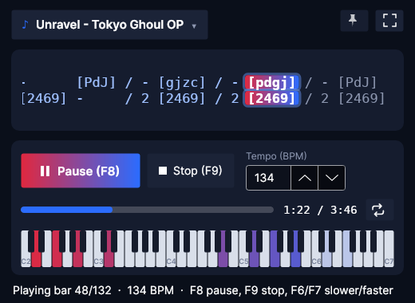
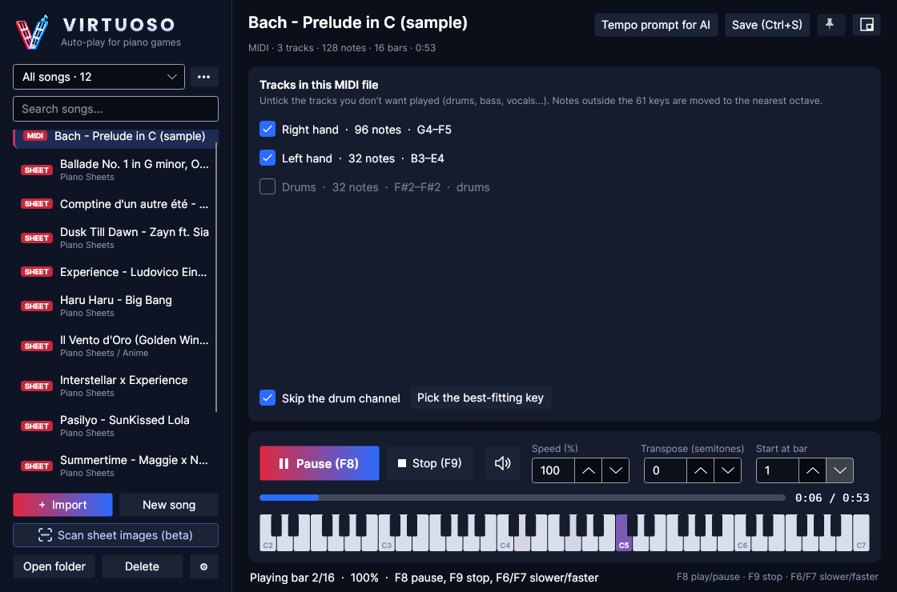

<div align="center">



<br>

[](https://github.com/tuforsa-rgb/virtuoso/releases/latest)
[](https://github.com/tuforsa-rgb/virtuoso/releases)
-0A0F1A?style=flat-square&logo=windows&logoColor=white)


### [⬇&nbsp; Download the latest version](https://github.com/tuforsa-rgb/virtuoso/releases/latest)

**Virtuoso** plays piano songs for you in piano games.<br>
Load a sheet or a MIDI file, press **F8** in the game, and listen.

</div>

---

<p align="center">
  
</p>

## ✨ Features

| | |
|---|---|
| 🎼 **Sheets** | Paste or import Virtual Piano letter sheets (`.txt`). Three layouts are understood: grid, space-separated and bars (one line = one bar). Write a bar as an `R:` line with an `L:` line under it and the two hands stay apart, in columns, like a piano score. Settings written at the top of a sheet (`; bpm: 120`) are applied automatically. |
| 🎹 **MIDI files** | Import `.mid` files, pick the tracks to play, skip drums, and let Virtuoso find the key that fits the 61 in-game keys best. Notes outside the range are moved to the nearest octave. |
| ⏱️ **Precise timing** | A dedicated scheduler keeps every note on time, even for long songs and when you change the speed in the middle of a song. |
| ⌨️ **Global hotkeys** | Control playback from inside the game — no need to switch windows. |
| 🎚️ **Full control** | Tempo, speed, transpose, start from any line or bar, key hold time, countdown and lead-in delay. |
| 🌏 **7 languages** | English, Tiếng Việt, 简体中文, Français, 日本語, 한국어, हिन्दी. |
| 🔔 **System tray** | Keeps running quietly in the tray; play, pause and stop from the tray menu. |
| 🔄 **Automatic updates** | Virtuoso tells you when a new version is out and installs it in one click. Every update is digitally signed and checked before it runs. |
| 📂 **Your own folders** | Click **Open folder** and every sheet and MIDI file in it shows up in the list, sub-folders included. Files stay where they are, and new ones appear by themselves. You can also drag files or folders onto the window. |
| ✨ **Follow along** | While a song plays, a cursor sweeps through the bar in time with the music — through both hands' lines at once — the notes being struck light up and the editor scrolls with it. An on-screen piano shows which keys are pressed. |
| 📷 **Scan sheet music** <sup>beta</sup> | Cut a page of piano sheet music with <kbd>Win</kbd>+<kbd>Shift</kbd>+<kbd>S</kbd> and press <kbd>Ctrl</kbd>+<kbd>V</kbd> in Virtuoso — or drop images or a PDF on the window. Virtuoso reads the notes, D.S./D.C./Coda jumps, 8va lines and tempo changes included, and writes a sheet you can play right away. The original pages sit beside the editor: the bar being edited or played is marked on them, clicking a bar jumps to its line, bars that may be read wrong are marked in red or amber, and any page can be scanned again on its own. |
| ⏩ **Seek** | Click or drag on the progress bar to jump anywhere in the song — also while it plays into the game. |
| 🔁 **Loop a part** | Select some lines and click 🔁 to play them over and over, seamlessly — or right-click the time bar to set A and B, or press <kbd>F4</kbd> twice from the game. Nothing selected loops the whole song. |
| 🤲 **One hand** | Let Virtuoso play only the right or the left hand and play the other one yourself. Two-hand sheets (`R:` / `L:` lines), scans and MusicXML know exactly which hand plays what; MIDI files use their tracks; other sheets are split at middle C — or turned into `R:` / `L:` lines with one right-click. |
| 🤝 **Share with a friend** | Link a folder you both sync (Google Drive, OneDrive…): sheets you scan into it show up in your friend's Virtuoso by themselves, original pages included. |
| 🔊 **Listen first** | The speaker button plays the song through your speakers, without sending any keys to the game. |
| 🧾 **MusicXML** | Import `.musicxml` / `.mxl` files from MuseScore, Finale, Sibelius and others; repeats and 1st/2nd endings are written out. |
| 🪟 **Compact & always on top** | Switch to a small player that sits next to the game (<kbd>Ctrl</kbd>+<kbd>M</kbd>) and pin it above the game (<kbd>Ctrl</kbd>+<kbd>T</kbd>). The song list is one click away. |

<p align="center">
  
</p>

<p align="center">
  
</p>

<p align="center">
  
</p>

## 📥 Installation

1. Go to **[Releases](https://github.com/tuforsa-rgb/virtuoso/releases/latest)** and download `Virtuoso-Setup-x.y.z.exe`.
2. Run the installer, choose your language, and follow the steps. You can create a desktop shortcut and start Virtuoso with Windows.
3. Open **Virtuoso** from the Start menu or the desktop.

> [!NOTE]
> Virtuoso is new and not yet code-signed, so Windows may warn you the first time.
> - **"Windows protected your PC"** (SmartScreen): click **More info → Run anyway**.
> - **Smart App Control** blocks apps that aren't signed. If it is turned on, Virtuoso can't run until it is turned off (Windows Security → App & browser control → Smart App Control).

## 🚀 Quick start

1. Click **+ Import** and choose sheets (`.txt`) or MIDI files (`.mid`), click **Open folder** to list a whole folder — or click **New song** and paste a sheet.
2. Select the song in the list and check the tempo.
3. Open your piano game and click into the game window.
4. Press **F8** to start. Virtuoso counts down, then plays.
5. Press **F8** again to pause, **F9** to stop.

### Hotkeys

| Key | Action |
|:---:|---|
| <kbd>F8</kbd> | Play / pause |
| <kbd>F9</kbd> | Stop |
| <kbd>F6</kbd> | Slower |
| <kbd>F7</kbd> | Faster |
| <kbd>F4</kbd> | Loop A–B: first press marks A, second marks B and loops, third stops |

The hotkeys work while the game is in front and are not passed on to the game.

Inside Virtuoso:

| Keys | Action |
|:---:|---|
| <kbd>Ctrl</kbd>+<kbd>M</kbd> | Compact mode on/off |
| <kbd>Ctrl</kbd>+<kbd>T</kbd> | Always on top on/off |
| <kbd>Ctrl</kbd>+<kbd>O</kbd> | Import files |
| <kbd>Ctrl</kbd>+<kbd>Shift</kbd>+<kbd>O</kbd> | Open a folder |
| <kbd>Ctrl</kbd>+<kbd>F</kbd> | Search songs (in the editor: search the sheet) |
| <kbd>Ctrl</kbd>+<kbd>S</kbd> | Save |
| <kbd>F5</kbd> | Read the folders again |

Right-click a line in the sheet editor and choose **Play from this line** to start there.

**Loop a part:** select the lines in the editor and click the 🔁 button next to the time (or right-click → **Loop these lines**). With nothing selected, the whole song loops. You can also right-click the time bar and choose **Loop from here (A)** / **Loop up to here (B)** — this works for MIDI files too — or, from inside the game, press <kbd>F4</kbd> at A and again at B. Click 🔁 (or press <kbd>F4</kbd>) again to stop looping.

**One hand:** set **Hands** to **Right hand** or **Left hand** and Virtuoso plays only those notes (from middle C up is the right hand), so you can play the other hand yourself.

## 📷 Scanning sheet music (beta)

1. Press <kbd>Win</kbd>+<kbd>Shift</kbd>+<kbd>S</kbd>, cut out the first page of the sheet, then press <kbd>Ctrl</kbd>+<kbd>V</kbd> in Virtuoso. The **Scan sheet images** window opens with that page.
2. Cut the next page and press <kbd>Ctrl</kbd>+<kbd>V</kbd> again — pages are added in order (use **Up** / **Down** if needed). You can also add image files or a whole PDF.
3. Press **Scan**. It takes about 10–30 seconds per page. Title and tempo are read from the sheet; you can also type them.
4. The new sheet opens in the editor with the **Original pages** beside it. Press the 🔊 button to listen, and fix what sounds wrong.
5. The bar you are editing — or playing — is marked on the original pages. Click a bar on a page to jump to its line in the editor (while playing, the music jumps there too).
6. Bars that may have been read wrong have a **red** (probably) or **amber** (maybe) mark in the editor's left margin and an outline on the page. Step through them with the **‹ ›** buttons above the pages; a line you change loses its mark.
7. A page came out badly? Click **Scan again** above it, or **Other picture** to paste or pick a clearer one. Only that page is read again — your fixes on the other pages stay.

The first scan downloads the scanner once (about 69 MB, plus 23 MB to read titles and tempo marks). It is [Audiveris](https://github.com/Audiveris/audiveris), free open-source music recognition, and everything runs on your computer — no pages are uploaded anywhere.

> [!TIP]
> Results are best with clean, straight pages of printed piano music: a full-width screenshot or a PDF works better than a photo taken at an angle. On a small screen (HD / HD+), zoom the sheet in or take half a page at a time — small pictures are read twice to keep the clearer reading, but bigger ones still read best. Notes usually come out right; the rhythm can still be off in a few bars. D.S., D.C., To Coda, Fine and the segno/coda signs are read, and the song is written out in playing order (a note at the top of the sheet says what was found). 8va lines are followed to their end, and tempo marks printed later in the song (and rit. / accel. / a tempo) change the tempo there. PDFs are turned into one picture per page, so everything above works for them too.

## 🤝 Sharing songs with a friend

Virtuoso has no account and no server: you share songs through a folder that both of you sync, for example with Google Drive or OneDrive.

1. One of you creates a folder in Google Drive (say **Our Piano Sheets**) and shares it with the other. Both install **Google Drive for desktop** so the folder is on your computers.
2. In Virtuoso, both click **Open folder** and pick that folder.
3. When you scan, choose the folder under **Save to**. The sheet is saved there as a `.txt` file with its original pages, and your friend's Virtuoso shows the new song by itself within a few seconds (at most ~30 s).

Any `.txt` or `.mid` file either of you puts in the folder appears too, and when one of you fixes a sheet, the other sees the new version.

## 🎼 Sheet formats

Virtuoso uses the standard 61-key Virtual Piano layout (C2–C7). Lowercase letters and numbers are white keys, Shift + key are black keys, and `[ ]` plays a chord.

<details open>
<summary><b>Two hands</b> — an <code>R:</code> line (right hand) with an <code>L:</code> line (left hand) under it is one bar</summary>

```
; bpm: 95
; mode: bars
R: J - / - - / - D / J l
L: ( w / t Y / - - / - -

R: J - / - j / - s / g h
L: q t / Y i / ( t / Y i
```
Both lines of a bar start together; notes in the same column are struck together. Scans and MusicXML files are written this way, in columns. **Hands → Right hand / Left hand** then plays exactly that line. To turn a one-line sheet into `R:` / `L:` lines, right-click the editor → **Split into right / left hand lines** (it splits at middle C; move any note that went to the wrong hand). Works with every layout below.
</details>

<details>
<summary><b>Bars</b> — one line is one bar, <code>/</code> splits the beats</summary>

```
; title: Ode to Joy
; bpm: 100
; mode: bars
; beatsperbar: 4
[8f] / f / [wg] / h
[5h] / g / [rf] / d
[8s] / s / [wd] / f
[5f] / - d / [rd] / -
```
Inside a beat, notes share the time equally (`- d` = rest, then D on the off-beat).
</details>

<details>
<summary><b>Grid</b> — every character or space is one step</summary>

```
; bpm: 120
; mode: grid
; notesperbeat: 4
t t y t i u   t t y t o i
```
</details>

<details>
<summary><b>Space-separated</b> — every note or chord is one step</summary>

```
; bpm: 90
; mode: spaced
; notesperbeat: 2
t t y t i u - t t y t o i
```
`-` is a rest of one step.
</details>

Not sure about the tempo? **Tempo prompt for AI** copies a ready-made question you can paste into any AI assistant to get the right settings for your sheet.

## 🔄 Updates

Virtuoso checks for a new version when it starts and every 12 hours. When one is available you'll see what's new and can choose **Update now**, **Later** or **Skip this version**. The update downloads, Virtuoso closes, installs it and opens again — your songs, settings and language stay as they are.

You can turn automatic checks off, or check by hand, in **Settings → Updates** or from the tray menu.

> Updates are published here as GitHub Releases. Each one is signed with the Virtuoso release key; a file that doesn't match its signature and checksum is deleted and never run.

<p align="center">
  
</p>

## 🛠️ Troubleshooting

<details>
<summary><b>The game misses some notes</b></summary>

Open **Settings** and raise **Key hold** (for example from 40 to 60 ms). Some games need keys held a little longer to register.
</details>

<details>
<summary><b>Nothing happens when I press F8</b></summary>

Make sure the game window is active (click into it first). If another program already uses F6–F9, Virtuoso shows a message in the status bar — close that program and restart Virtuoso.
</details>

<details>
<summary><b>Wrong notes / everything sounds shifted</b></summary>

Turn **Caps Lock** off. If the sheet was written for a transposed piano, set **In-game transpose** to the value written on the sheet.
</details>

<details>
<summary><b>The window is blank or flickers</b></summary>

Start Virtuoso with software rendering: right-click the shortcut → Properties → add <code>--software-render</code> at the end of <i>Target</i>.
</details>

<details>
<summary><b>Where are my songs stored?</b></summary>

In `%AppData%\Virtuoso\Songs`. Click **Open folder** in the app to go there. Uninstalling asks before deleting them.
</details>

## 💻 System requirements

- Windows 10 or Windows 11, 64-bit
- About 100 MB of disk space
- No extra runtime needed — everything is included in the installer

## 🔒 Privacy

Virtuoso does not collect or send any personal data. The only internet access is the update check, which downloads release information from this page, and — only when you scan sheet music for the first time — the download of the scanner from this page. Scanning itself runs entirely on your computer.

## 📝 Changelog

**1.3.12** — two-hand sheets and a sweeping cursor
- New sheet layout: each bar is an `R:` line (right hand) with an `L:` line (left hand) under it, in columns like a piano score. Scans and MusicXML imports are written this way.
- While a song plays, a cursor sweeps through the bar in time with the music, through both hands' lines; the notes of both hands light up together. The compact player shows both lines.
- **Hands → Right / Left** plays exactly the `R:` or `L:` line; MIDI files with several tracks use their tracks (the lowest one is the left hand).
- Right-click → **Split into right / left hand lines** turns a one-line sheet into `R:` / `L:` lines.
- Bars of two-hand sheets count as one everywhere: Start at bar, loops, F4, the original pages, the bars-to-check marks and page rescans.

**1.3.11** — small screenshots scan better, bug fixes
- Small screenshots (HD and HD+ screens) scan better: small pages are read two ways and the reading with fewer doubtful bars is kept. On 7 songs captured at HD+, bars that sound right went from 72% to 77%.
- 8va / 8vb lines the recogniser missed are found from the picture, so whole passages no longer come out an octave off.
- Phone photos stored sideways are turned upright; dark-mode screenshots (light notes on a dark page) can be scanned; pictures that are too small get a clear tip.
- "New song" no longer keeps the previous song's loop, pages and marks. Search ignores accents ("con co" finds "Con Cò").
- Songs titled "Con", "Aux", "Nul"… can be saved on Windows. Deleting "Song.mid" no longer deletes the scanned pages of "Song.txt" beside it. Stray files in a shared folder (Thumbs.db…) are no longer taken for pages.
- Damaged MIDI and MusicXML files no longer freeze the app; "timewise" MusicXML opens; linking a whole drive (D:\) works.

**1.3.10** — bug fixes for 1.3.9 ("1.3.9 v2")
- Loop: setting or changing a loop just after point B was played now goes back to A instead of playing on to the end.
- Choosing a hand that has no notes in the song now says so, instead of calling the song empty.
- PDFs with Vietnamese (or other non-English) file names can now be scanned on Windows.
- Songs in a shared folder: when a page was scanned again on the other computer, the original pages reload too.
- Scanning a page again after lines were added or removed now explains why, and still lets you go on.
- "Other picture → Paste" only takes pictures; the ‹ › buttons no longer jump around while paused.

**1.3.9** — bars to check, rescanning a page, PDFs, one hand
- Bars that may have been read wrong are marked (red: probably, amber: maybe) in the editor and on the original pages, with ‹ › to step through them. A corrected line loses its mark.
- Scan one page again, from the same picture or another one; the other pages and your fixes stay.
- PDFs become one picture per page: bar marking, click-to-line, segno/coda and per-page rescans work for them too.
- 8va lines now apply all along their dashed line (they used to stop after the first notes).
- Tempo changes inside a scanned song: later tempo marks, rit. / accel. / a tempo.
- **Hands**: play only the right or the left hand.
- <kbd>F4</kbd>: loop A–B from inside the game.

**1.3.8** — pages linked to the sheet, loops, D.S./Coda
- The original pages of a scanned song follow the sheet: the bar at the caret, or being played, is marked on its page and the page scrolls along. Click a bar on a page to jump to its line (also while playing); click a repeated bar again for its next time.
- A–B loop: select lines and click 🔁 (or right-click → **Loop these lines**), or set A and B with a right-click on the time bar. Nothing selected loops the whole song. The loop is seamless.
- Scanning reads D.S., D.C., To Coda and Fine, finds segno and coda signs on the page, and writes the song out in playing order.

**1.3.7** — seek, shared folders, automatic titles
- Seek: click or drag on the progress bar to jump anywhere, also while playing (the focus goes back to the game and the song carries on). When stopped, it picks where Play starts.
- Share songs through a synced folder: scans can be saved straight into a linked folder (with their pages), and songs a friend adds or changes there show up by themselves.
- Scans name themselves after the title printed on the sheet, accented Vietnamese titles included.

**1.3.6** — better scans, no lag on top
- Scanning is much more accurate: pages are sharpened before they are read, so far fewer rests, dots and flags are lost; scanned bars always keep their real length.
- The tempo printed on the sheet ("♩ = 90") is read; if there is none, type the BPM in the scan window. The printed title is used when you leave the title empty.
- Fixed lag and odd sounds while playing with **Always on top**: Virtuoso now redraws far less while it plays into the game and keeps time better when the game keeps the computer busy.

**1.3.5** — beta of sheet scanning
- Scan sheet music: paste pages cut with <kbd>Win</kbd>+<kbd>Shift</kbd>+<kbd>S</kbd> (<kbd>Ctrl</kbd>+<kbd>V</kbd>), or drop images or a PDF. The original pages open beside the editor.
- The scanner (Audiveris, ~69 MB) is downloaded on first use and can be removed in Settings.
- Many rhythm mistakes of the recognition are repaired automatically from where the notes are printed.
- Listen: play the song through the speakers without sending keys to the game.
- Import MusicXML (`.musicxml`, `.mxl`).

**1.3.0**
- Compact mode: a small player to keep next to the game; the song list folds into a button.
- Always on top: keep Virtuoso above the game (pin button, <kbd>Ctrl</kbd>+<kbd>T</kbd> or the tray menu).
- Open folder: every sheet and MIDI file in a folder (and its sub-folders) shows up in the list; new files appear by themselves.
- The note being played lights up in the sheet and the editor follows it; an on-screen piano shows the keys.
- New sheet editor with line numbers and colours.
- Smoother screen updates while playing, faster search.
- Drag and drop, "Play from this line", deleted songs go to the Recycle Bin, the window remembers its size and place.

**1.2.0**
- New look: a brand-new app icon and logo, plus new artwork in the installer and the welcome screen.
- Fixed: the license page in the installer showed the app's old name.

**1.1.0**
- Automatic updates: checks for new versions, downloads and installs them in one click (signed and verified).
- New **Updates** section in Settings and **Check for updates** in the tray menu.

**1.0.0**
- First release: sheets and MIDI, global hotkeys, system tray, installer, 7 languages.

## ⚖️ Disclaimer & license

Virtuoso simulates keyboard presses to play virtual pianos. Some games and platforms do not allow automation software — you are responsible for following the rules of the games you use it with. Please don't use it in contests or rankings.

Virtuoso is an independent product and is **not affiliated with, endorsed by or sponsored by Roblox Corporation** or any game developer. All trademarks belong to their respective owners. No songs are included; only load music you have the right to use.

© 2026 Virtuoso. All rights reserved. Use of the software is subject to the license agreement shown in the installer.

The optional sheet scanner is [Audiveris](https://github.com/Audiveris/audiveris) 5.10.2, © Hervé Bitteur and the Audiveris contributors, licensed under the [GNU AGPL-3.0](https://github.com/Audiveris/audiveris/blob/5.10.2/LICENSE). It is downloaded separately, unchanged, and runs as its own program; its complete source code is at [github.com/Audiveris/audiveris/tree/5.10.2](https://github.com/Audiveris/audiveris/tree/5.10.2). Titles and tempo marks are read with the English and Vietnamese data of [Tesseract](https://github.com/tesseract-ocr/tessdata/tree/4.1.0) (Apache-2.0), downloaded from the Tesseract project.
